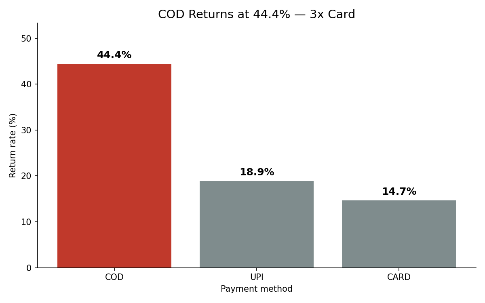
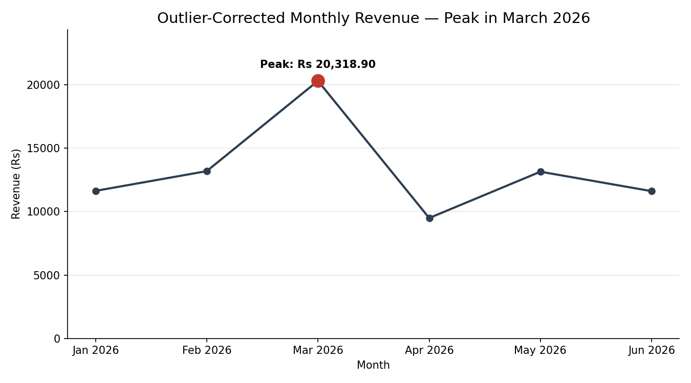

# 📦 Mamaearth Returns & Growth Intelligence Pipeline

An end-to-end data analytics project that investigates product returns, revenue discrepancies, and customer purchasing patterns using **MySQL, Python, and Generative AI**.

The pipeline transforms raw retail data into verified business insights through SQL reporting, Python-based data cleaning and EDA, and automated AI-generated narratives.

## 🛠️ Tech Stack

- **SQL:** MySQL, joins, aggregations, subqueries, CASE statements
- **Python:** Pandas, Matplotlib, exploratory data analysis
- **GenAI:** Google Gemini API, automated narrative generation
- **Tools:** MySQL Workbench, VS Code, Git, GitHub

## 📂 Project Structure

```text
├── data/
│   ├── customers.csv
│   ├── products.csv
│   └── orders.csv
├── sql/
│   ├── schema.sql
│   ├── seed_data.sql
│   └── reports.sql
├── analysis/
│   ├── clean_and_eda.py
│   └── visualize.py
├── visualizations/
│   ├── return_rate_by_payment.png
│   └── monthly_revenue_trend.png
├── narrator/
│   ├── findings.json
│   ├── generate_narrative.py
│   └── sample_output.txt
├── requirements.txt
└── README.md
```

## 🔄 Pipeline Workflow

1. **SQL Layer:** Creates relational tables, loads raw data, and generates nine analytical reports.
2. **Python Layer:** Standardizes payment methods, removes duplicate orders, handles missing values, detects outliers, and analyzes return patterns.
3. **GenAI Narrator:** Reads verified findings from `findings.json` and generates a Situation–Complication–Resolution narrative using Gemini or an offline fallback.

## 📊 Key Findings

| Metric | Result |
|---|---:|
| Raw orders analyzed | 180 |
| Duplicate orders removed | 5 |
| Orders after cleaning | 175 |
| Raw SQL revenue | ₹99,860.20 |
| Cleaned revenue | ₹97,358.30 |
| Revenue difference | ₹2,501.90 |
| COD return rate | 44.4% |
| UPI return rate | 18.9% |
| Card return rate | 14.7% |
| Highest-risk segment | Tier 2 COD orders — 54.5% return rate |

**Business insight:** COD orders show higher return rates than UPI and card orders in this dataset. Tier 2 COD orders represent the highest-risk segment and warrant further operational investigation.

The revenue reconciliation identifies a ₹2,501.90 difference associated with five duplicate orders removed during cleaning.

## 📈 Visualizations

### Return Rate by Payment Method



### Monthly Revenue Trend



The monthly analysis identifies March 2026 as the peak month after accounting for bulk-order outliers.

## 🚀 Getting Started

### 1. Install Dependencies

```bash
pip install -r requirements.txt
```

### 2. Run the SQL Layer

Open MySQL Workbench and execute the following scripts in order:

1. `sql/schema.sql`
2. `sql/seed_data.sql`
3. `sql/reports.sql`

Create and select the database before running the scripts:

```sql
CREATE DATABASE IF NOT EXISTS mamaearth;
USE mamaearth;
```

Verify the loaded record counts:

```sql
SELECT COUNT(*) FROM customers; -- 45
SELECT COUNT(*) FROM products;  -- 16
SELECT COUNT(*) FROM orders;    -- 180
```

For the loyalty-tier update in report (i), disable safe updates for that session if required. Reset the schema before rerunning the report if the loyalty column already exists.

### 3. Run Python Analysis

From the repository root:

```bash
python analysis/clean_and_eda.py
python analysis/visualize.py
```

The analysis script generates `narrator/findings.json`, while the visualization script saves the charts in `visualizations/`.

### 4. Generate the Narrative

```bash
python narrator/generate_narrative.py
```

The narrator uses the Gemini API when configured and falls back to a fixed offline template if the key is missing or the API call fails.

To enable Gemini on PowerShell:

```powershell
$env:GEMINI_API_KEY = "your-api-key"
python narrator/generate_narrative.py
```

## ✅ Data Quality & Validation

- Raw CSV files remain unchanged; cleaning is performed programmatically.
- Five duplicate orders are removed during Python preprocessing.
- Missing discounts and ratings are handled according to the analysis script.
- Revenue is reconciled between SQL and Python to explain the impact of duplicate removal.
- Outliers are flagged and retained, with bulk orders excluded from the adjusted monthly revenue comparison where appropriate.
- The narrator checks for five required figures and reports PASS or FAIL.
- An offline narrative fallback avoids making the Gemini API mandatory.

## 🎯 Business Value

This project demonstrates how SQL reporting, Python data analysis, and GenAI can work together to:

- Identify high-return customer and payment segments.
- Improve visibility into revenue discrepancies and data quality.
- Investigate unusual revenue spikes.
- Convert verified analytical results into concise, actionable business narratives.

## 👨‍💻 Author

**Kartik Chhonkar**

Data Analyst | SQL | Python | Data Analytics | Generative AI
